# Basement Cinema — design review

What to keep, what to fix, and what to do while the ceiling is still open. Every image is a render from the planner (`../index.html`). Load the recommended version there with **Furnish › Design option › Recommended**.

The slide deck version lives on claude.ai (Basement Cinema Design Review). Its slide sources are in `deck/`: `deck.json` plus one HTML file per slide; their images point at the deck's uploaded copies of the renders in `renders/`.

The renders use the corrected site measurements: a 10′-9″ TV alcove, a 3′-9″ deep fireplace nook, 3′-11″ from the bottom step to the wall in front, 11′-6″ from the tip of the stairs to the exterior wall, the fireplace bulkhead running out over the stair landing, and the stairs open on the far side to the hallway.

## Where the room stands

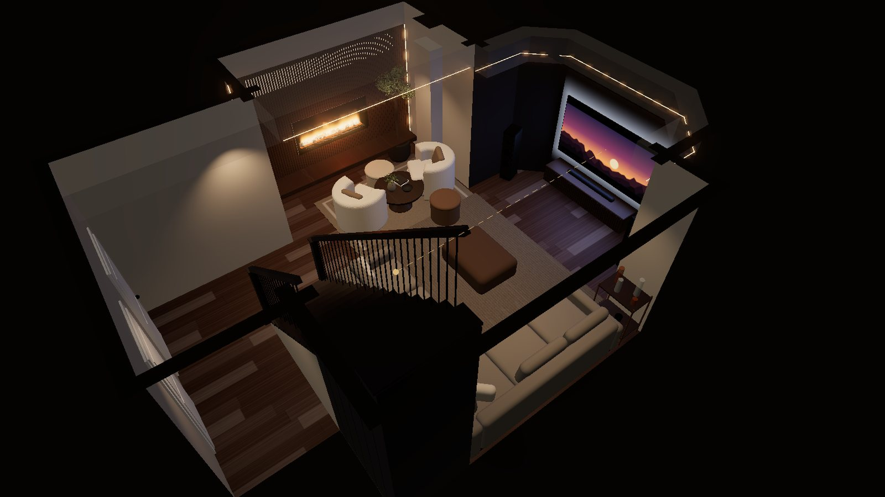

| Keep | Fix |
| --- | --- |
| Walnut slat wall with LED edges on the fireplace side | The fireplace wall reads as a face |
| Dark TV alcove under the stepped bulkhead | Two pot lights make a second face over the TV, and glare |
| L-sectional on the stair wall and the exterior wall | A 75″ TV fills 23° of view from the sofa; cinema wants 30°+ |
| Warm 2700K LED coves and the bouclé lounge by the fire | About 2′ of path from the foot of the stairs |
| | Dark stairs during movies |
| | The ceiling is open: soundproof and pre-wire now |

## Hiding the robot face

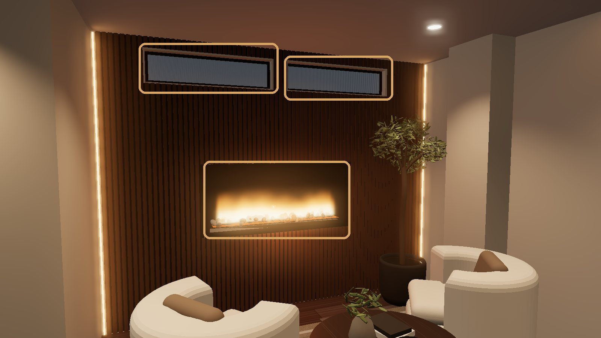

Two equal windows side by side, with a wide fireplace centred below, give the eye two eyes and a mouth. Tall, jagged flames read as teeth, and the LED edges frame it like a head. The openings are already cut, so every fix keeps them: join the two eyes into one shape, hide them, or break the symmetry.

**Fix A, recommended: slats across, one glow band.** The slats continue over both windows. A 2700K strip behind them, along the window line, makes one band of light, and the windows still borrow light from next door. A floating walnut bench under the fireplace adds perch seating. Set the flame effect low and even.

| Before | After |
| --- | --- |
| 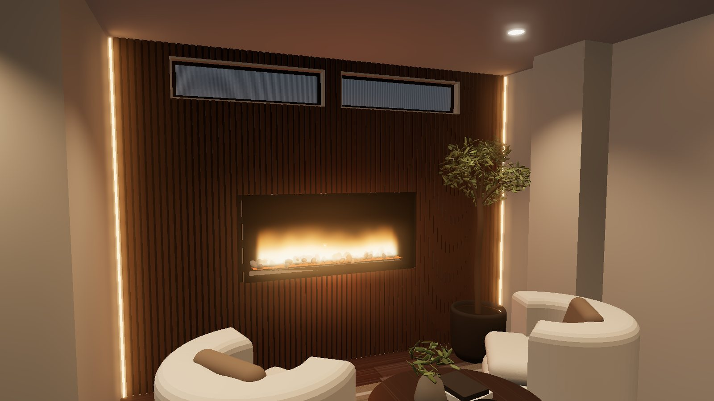 | 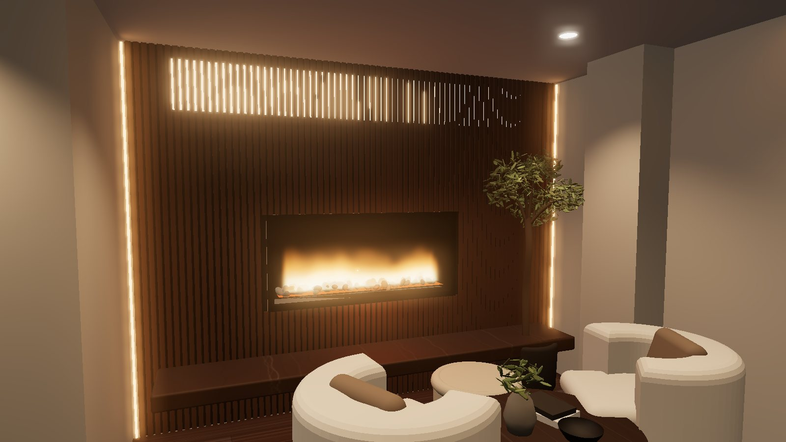 |

**Fix B: one black frame and a ledge.** A 2″ black steel surround goes around both windows, with the strip between them clad black, so they read as one long window. A walnut ledge between the windows and the fireplace separates the eyes from the mouth.

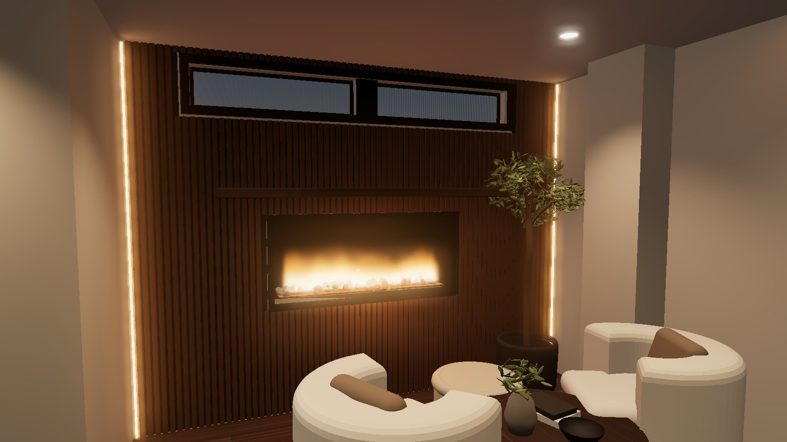

**Three more looks for the same wall.** All five are one click in the planner under **Finishes › Fireplace wall looks**, and each piece can be mixed and matched under *Windows above the fireplace* and *Around the fireplace*.

| C · Hidden windows + stone | D · Black band + art | E · Linen shade + shelves |
| --- | --- | --- |
| 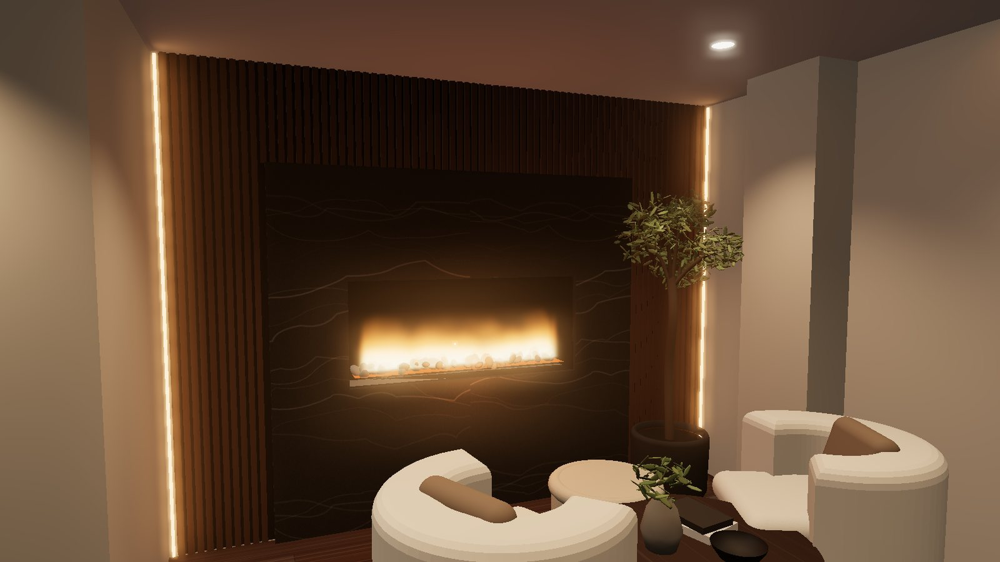 | 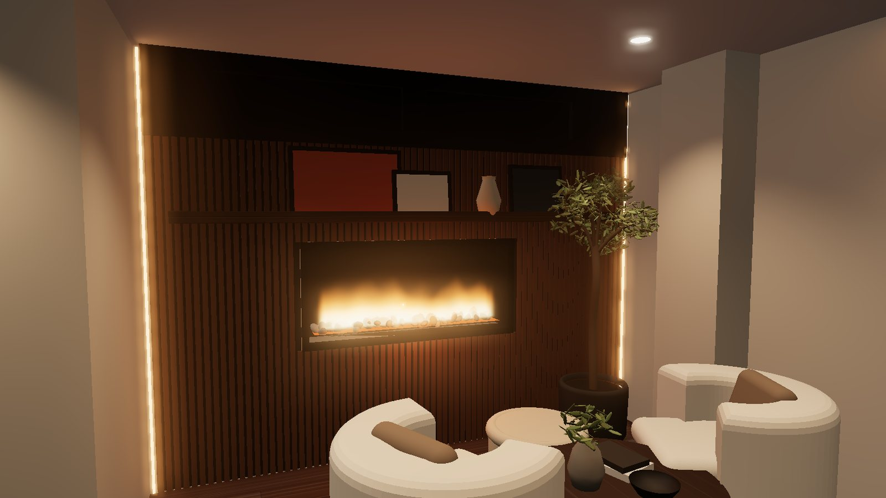 | 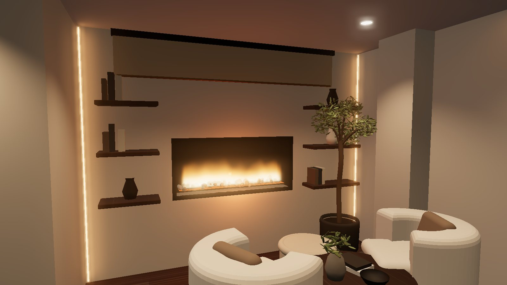 |
| Slats and black felt close over both windows, and a tall porcelain or stone panel frames the fire. No eyes left at all. | A matte-black band runs wall to wall at window height, so the windows become two slots in one stripe. Art leaned off-centre on a ledge breaks the symmetry. | One linen shade covers both windows as a single soft panel. Open shelves either side make the fireplace part of a wider wall. Works without the slats. |

C and D need privacy film or tinted glass so no light leaks from the next room. For the picture ledge, check the fireplace's clearance to combustibles above the opening.

**The TV wall has a face too.** The two pots in front of the bulkhead paint two bright scallops over the screen and glare on it. Drop them, or aim adjustable trims at the angled walls. Let the LED cove and a bias light do the rest.

| Before | After |
| --- | --- |
| 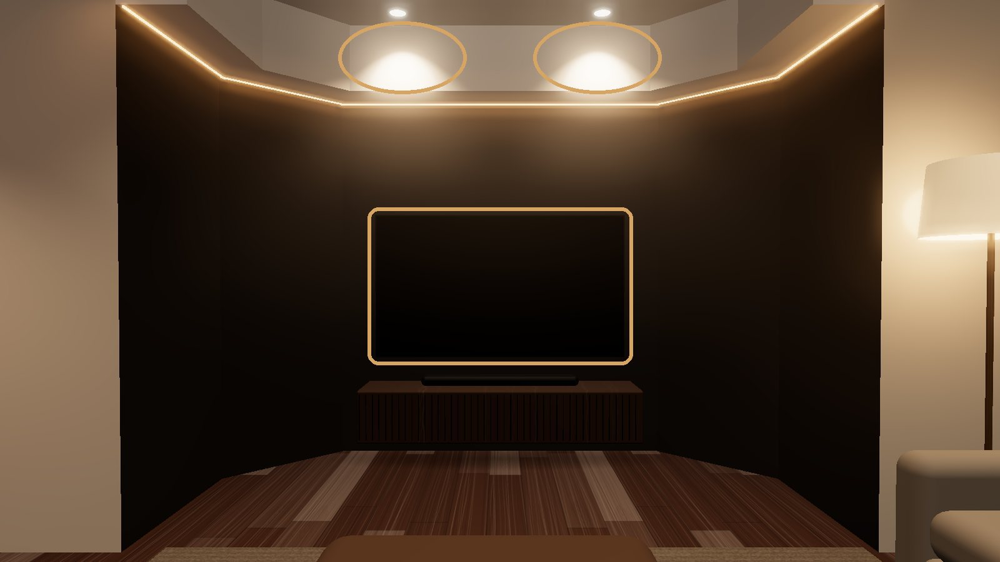 | 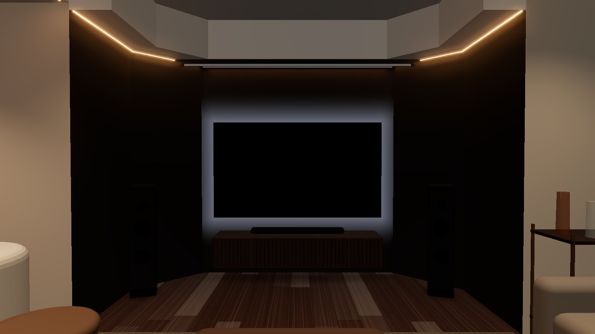 |

## A picture big enough for the seat

From the prime seat the TV is 13′-6″ away. Cinema guidance asks the picture to fill at least 30° of view (SMPTE), ideally 36–40° (THX).

| Option | Picture width | Fills | Fits the 84″ TV wall |
| --- | --- | --- | --- |
| 75″ TV, as planned | 65½″ | 23° | Yes, 9″ each side |
| **85″ TV** | 74″ | 26° | Yes, 5″ each side |
| 98″ TV | 85½″ | 30° | No, 1½″ too wide |
| **110″ drop-down screen** | 96″ | 35° | Yes, hangs 9″ off the wall |

Recommended: the 85″ TV for every day, and a motorised 110″ screen in a pocket in the alcove bulkhead for movie nights, with a ceiling projector about 11′ back.

| Movie night | Bias light, game night |
| --- | --- |
| 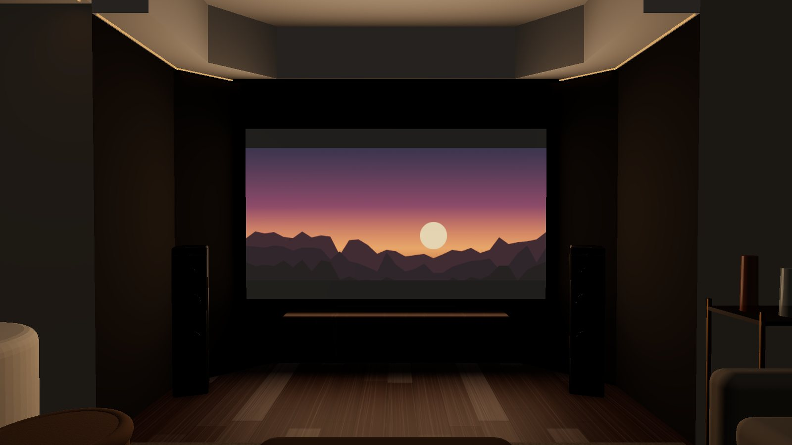 | 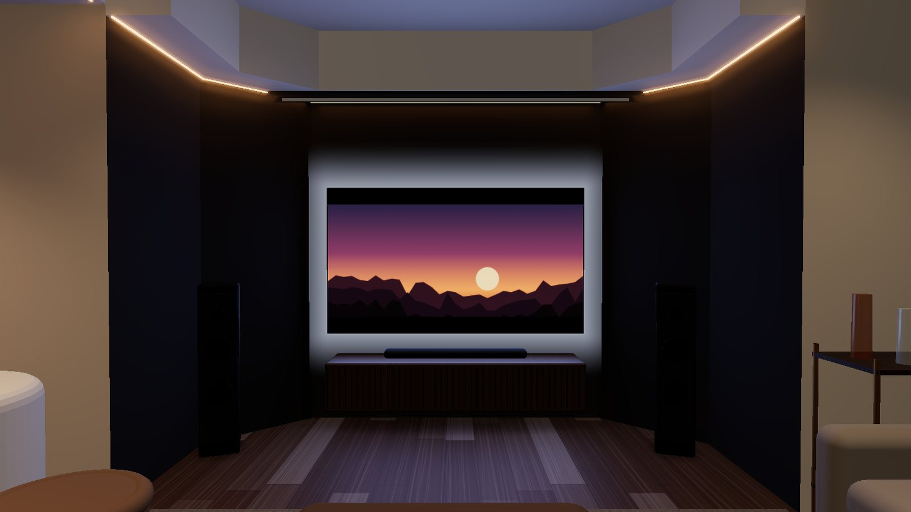 |

A 6500K bias strip on the back of the TV eases eye strain in a dark room and makes blacks look deeper. Keep the warm 2700K for the room.

## A better hangout room

| As drawn | Recommended |
| --- | --- |
| 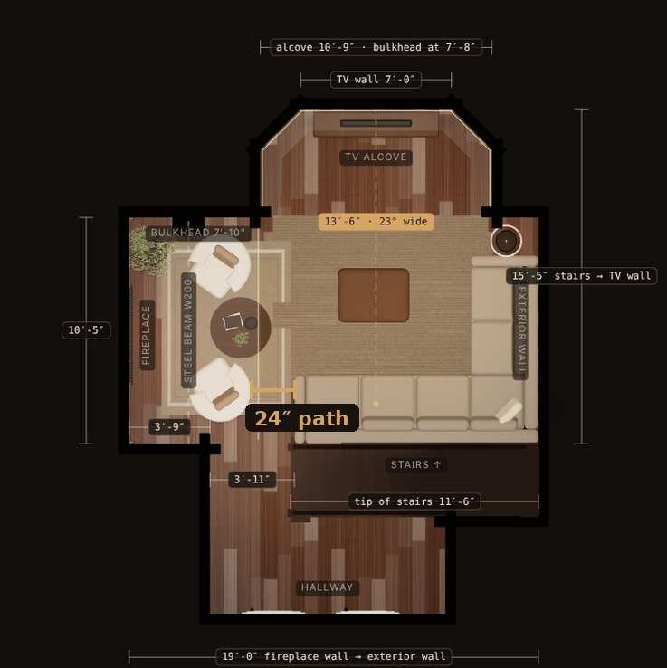 | 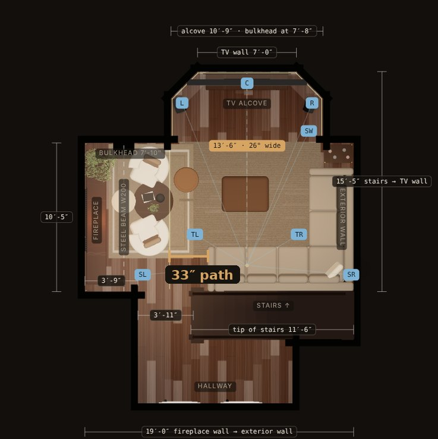 |

Order the sectional's back leg 1′ shorter (124″ instead of 136″) and pull the lounge chairs north. The foot of the stairs opens from 24″ to 33″ (measured in the planner), and the prime seat still lines up with the TV. Add two poufs and a bar cart in the corner pocket for game night, and step lights in the stair wall for movie nights.

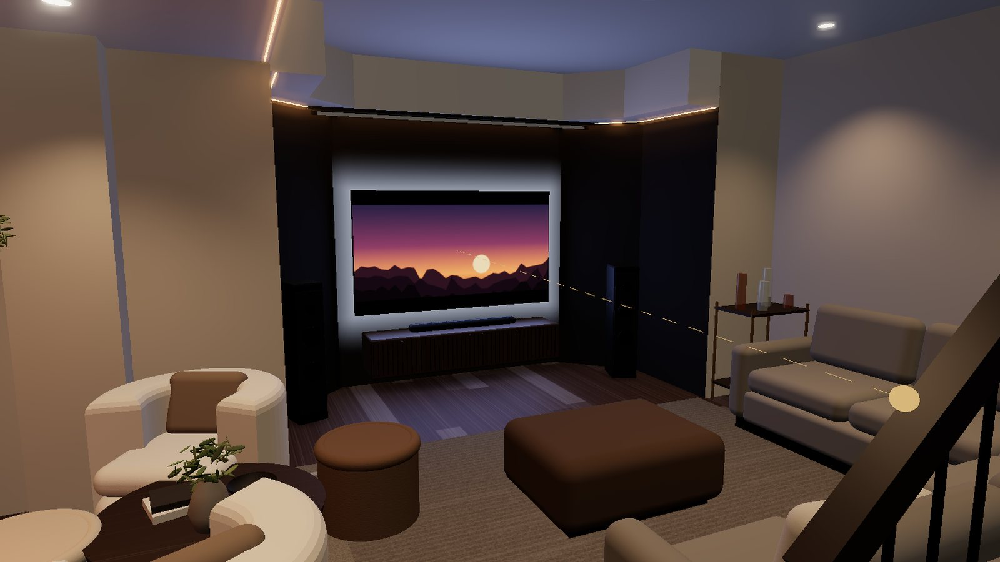

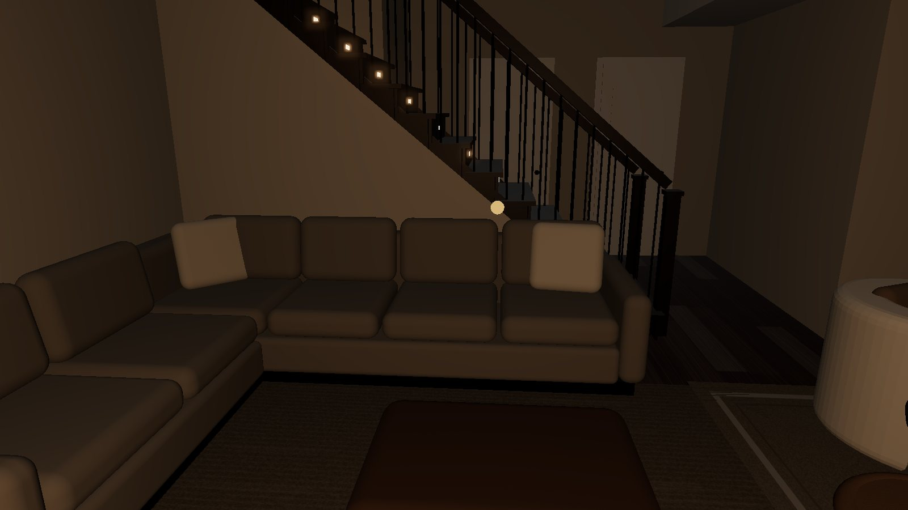

## Before the ceiling closes

- **Soundproofing.** Mineral wool in every joist bay, resilient channel or sound clips, then 5/8″ drywall. Go to two layers with damping compound if bedrooms are above.
- **Speaker wire, 5.1.2.** Front left, centre, front right, sub, two surrounds and two in-ceiling Atmos speakers, all run back to the console. The left surround goes in the ceiling because there is no wall there (planner: Room › Overlays › Speaker pre-wire plan).
- **Video and power.** Conduit from the console to the TV mount and to the projector spot, plus power for the projector and the screen pocket.
- **Framing.** Blocking behind the TV patch for the mount, and a framed pocket in the bulkhead for the screen.
- **Lighting zones.** Separate dimmers for the room pots, alcove, LED coves, slat-wall LEDs and step lights.

## Next steps

1. Pick the fireplace wall look: A, slats across with a glow band; B, one black frame and a ledge; or one of C to E.
2. Before drywall: soundproof, pre-wire 5.1.2, run conduit, frame the screen pocket and the TV blocking, set the dimmer zones.
3. Order the 85″ TV, and a sectional with a 124″ back leg.
4. Add the screen and projector whenever you like; the pocket and wiring will be waiting.
